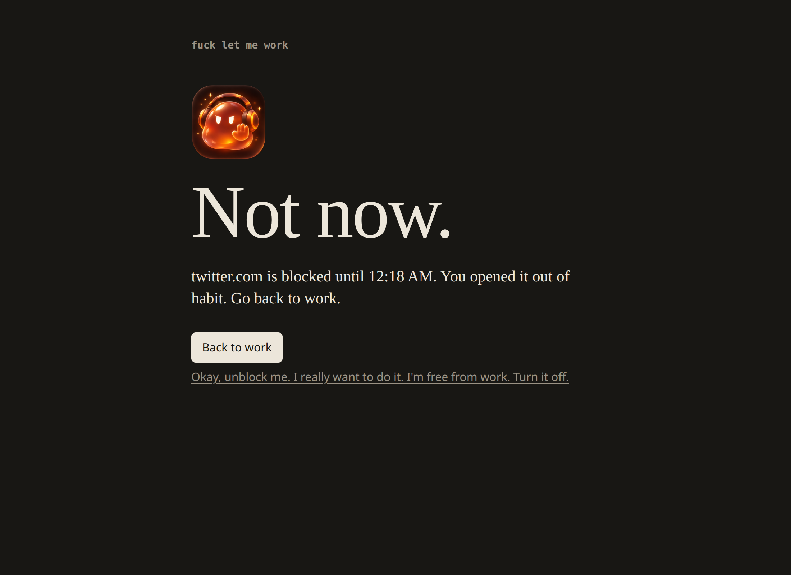
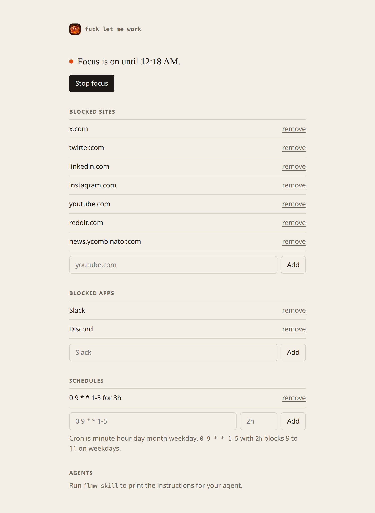
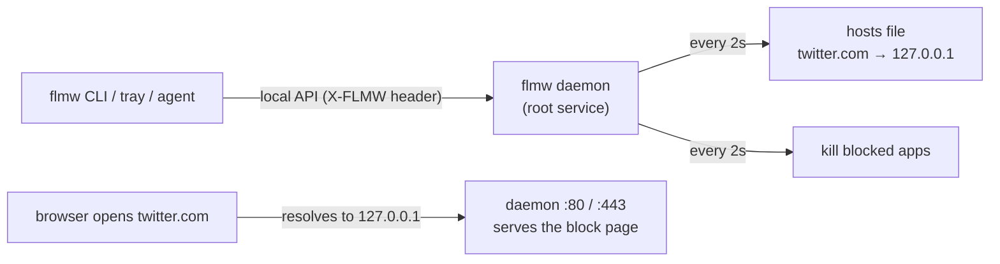

# fuck let me work

I open Twitter while walking to the kitchen. Then 40 minutes are gone.

`flmw` blocks websites and closes apps while you focus. Open twitter.com during focus and you get this instead:



The small link at the bottom turns focus off, because sometimes you really are done.

It runs on macOS, Linux and Windows. You can turn it on from the terminal, the menu bar, a web page, or let your AI agent do it.

## Install

**macOS and Linux**

```sh
curl -fsSL https://raw.githubusercontent.com/ramxcodes/fuck-let-me-work/main/install.sh | sh
```

The script downloads the latest release for your system, checks its SHA-256 checksum, and runs `sudo flmw install`. Read [install.sh](install.sh) first if you like; it is 40 lines.

**Windows**

Download `flmw-windows-amd64.exe` (or `arm64`) from [Releases](https://github.com/ramxcodes/fuck-let-me-work/releases), rename it to `flmw.exe`, and run `flmw.exe install` in an Administrator terminal. Then add `C:\Program Files\fuck-let-me-work` to your PATH.

**With Go** (1.26 or newer)

```sh
go install github.com/ramxcodes/fuck-let-me-work/cmd/flmw@latest
sudo "$(go env GOPATH)/bin/flmw" install
```

`flmw install` does four things:

1. Copies the binary to a folder only admins can change.
2. Registers a background service (launchd, systemd or a Windows service) that runs as root.
3. Makes a local certificate authority (CA) and adds it to your system trust, so blocked HTTPS sites show the block page and not a certificate warning.
4. Starts the service and waits until it answers.

## Use

```sh
flmw on 25m          # focus for 25 minutes
flmw on              # focus until you stop it
flmw off
flmw status
```

```
$ flmw status
Focus: ON until 00:06 Wed (manual)
Sites: x.com, twitter.com, linkedin.com, instagram.com, youtube.com, reddit.com
Apps:  Slack, Discord
Schedule s1795542385601: "0 9 * * 1-5" for 3h
```

Your lists are saved, so you set them up once:

```sh
flmw site add youtube.com reddit.com   # full URLs work too
flmw site rm linkedin.com
flmw app add Slack Discord             # process names, any case
flmw schedule add "0 9 * * 1-5" 3h     # weekdays, 9 to 12
flmw schedule rm <id>                  # ids are in "flmw status"
```

Sites and apps are blocked only while focus is on. Out of the box the list is x.com, twitter.com, linkedin.com and instagram.com.

`flmw off` inside a schedule window pauses blocking until that window ends. Otherwise the schedule would switch blocking back on two seconds later.

### Control panel

`flmw open`, or go to http://127.0.0.1. Same lists, same buttons.



### Menu bar

`flmw tray` puts a dot in your menu bar or system tray: orange while focus is on, grey when off. Click it to start 25m, 50m, 2h, or focus until you stop. On Linux, GNOME needs the AppIndicator extension to show tray icons.

### AI agents

```sh
flmw skill
```

prints a [SKILL.md](skill/SKILL.md) that teaches an agent the commands and the `--json` output. Save it as `~/.claude/skills/flmw/SKILL.md` (or wherever your agent reads skills), then ask it to "block YouTube for the next hour".

## How it works



One Go binary, four jobs:

- **`flmw daemon`** is the root service. Every 2 seconds it reads the config, decides if focus is on (manual session, schedule, or paused), and makes the system match:
  - It writes a marked block to the hosts file that points blocked sites at 127.0.0.1. When focus ends or the service stops, it removes the block and your hosts file is byte-for-byte what it was.
  - It kills processes whose name matches a blocked app (on macOS, also anything inside `Name.app`). It only touches processes of normal login users, never root, SYSTEM or other system accounts.
- **The page.** The daemon listens on 127.0.0.1 ports 80 and 443. On a blocked site it shows "Not now." On `http://127.0.0.1` it is the control panel. It is one HTML file.
- **HTTPS.** When the browser asks for `https://twitter.com`, the daemon signs a certificate for that name with the local CA, so the page loads with no warning. It only signs names that are on your list.
- **The CLI and tray** only talk to the daemon over its API. The API needs an `X-FLMW: 1` header and only answers to localhost or a blocked site's name, so other websites can't call it from your browser.

| | macOS | Linux | Windows |
|---|---|---|---|
| binary | `/Library/Application Support/fuck-let-me-work/flmw` (linked from `/usr/local/bin/flmw`) | `/usr/local/bin/flmw` | `%ProgramFiles%\fuck-let-me-work\flmw.exe` |
| config and CA | `/Library/Application Support/fuck-let-me-work` | `/var/lib/fuck-let-me-work` | `%ProgramFiles%\fuck-let-me-work` |
| service log | `/var/log/fuck-let-me-work.err.log` | `journalctl -u fuck-let-me-work` | Event Viewer |

## Limits

This stops habits, not a determined you. Any program on your machine can call the local API, which is how agents use it.

- The hosts file has no wildcards. `youtube.com` also blocks `www.youtube.com`, but `m.youtube.com` needs its own `site add`.
- A browser can keep a site open for about a minute after focus starts, until its DNS cache expires.
- A browser with its own DNS-over-HTTPS setting can skip the hosts file. Turn it off, or set it to use the system resolver.
- Firefox on macOS: if you see a certificate warning, set `security.enterprise_roots.enabled` to `true` in `about:config`.
- Chrome and Firefox on Linux keep their own certificate lists. `install` adds the CA to them when `certutil` is installed (Debian/Ubuntu: `libnss3-tools`).
- Ports 80 and 443 must be free. A local dev server or Docker on those ports stops the service from starting.

## Uninstall

```sh
sudo flmw uninstall
```

Removes the service, the CA from your trust stores, the hosts block, the binary and the config.

## Develop

```sh
go test ./...

# Run the daemon on a temp hosts file and high ports. No root, no changes to your system:
go run ./cmd/flmw daemon --data-dir /tmp/flmw --hosts /tmp/hosts --http 127.0.0.1:18080 --https 127.0.0.1:18443
FLMW_URL=http://127.0.0.1:18080 go run ./cmd/flmw on 25m
```

Push a tag like `v0.2.0` and [the release workflow](.github/workflows/release.yml) builds every binary and publishes the release.

## License

MIT
